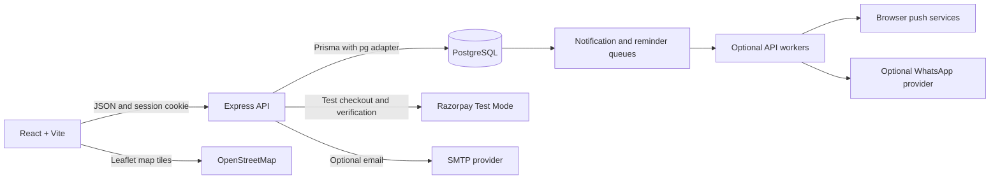

# CampusConnect

CampusConnect is a campus event discovery and registration application. Students can find published events, register, and manage their registrations; organizers can publish and manage events and review attendees. It is a personal CSE portfolio project intended to be cloned and run locally.

## Problem and objectives

Campus event details are often spread across disconnected channels, making events harder for students to find and harder for organizers to manage. CampusConnect brings event discovery, registration, and event administration into one application.

- Give students one place to browse events and track registrations.
- Give organizers tools to create and manage events and attendee lists.
- Enforce authentication, role checks, event ownership, validation, and duplicate-registration rules on the server.

## Features

**Students**

- Create and verify an account, sign in, and recover a password.
- Browse published events, inspect event details, and register for free events.
- Use Razorpay Standard Checkout for paid registrations in **Test Mode only**.
- Review registrations and view registration and event-cancellation notifications in the in-app notification centre.
- View venue maps and directions when event coordinates are available.
- Configure optional browser push and WhatsApp reminder preferences.

**Organizers**

- Create, edit, publish, unpublish, cancel, and delete owned events.
- Set event category, venue, schedule, ticket price, and optional capacity and coordinates.
- Review attendees and available capacity from the organizer dashboard.
- Cancel events while retaining registration records and notifying affected students in-app. CampusConnect does not issue refunds.

## Technology

| Area | Stack |
|---|---|
| Frontend | React 19, TypeScript, Vite, React Router, Leaflet, React-Leaflet |
| API | Node.js, Express 5, TypeScript, Zod |
| Data | PostgreSQL, Prisma ORM, `pg` adapter |
| Authentication | `express-session`, PostgreSQL session store, Argon2 |
| Integrations | Razorpay Standard Checkout, Nodemailer/SMTP, Web Push, optional WhatsApp providers, OpenStreetMap tiles |
| Quality | Vitest, Supertest, Testing Library, Oxlint |

## Architecture and request flow



React pages call the Express API with JSON and a session cookie. Express validates requests, resolves the server-side session, checks roles and event ownership, then uses Prisma and PostgreSQL constraints/transactions to persist changes. Razorpay order creation and payment verification happen on the API; maps load in the browser from the configured tile provider. Email, push, and WhatsApp delivery require optional provider configuration. In-app notification history is stored in PostgreSQL.

See [architecture documentation](./docs/architecture.md) for component responsibilities, request flow, and database relationships.

Authentication uses PostgreSQL-backed server sessions and Argon2 password hashes. Public registration creates student accounts only. Organizer accounts must be provisioned separately; see [the demo guide](./DEMO_GUIDE.md). The Prisma schema and ordered SQL migrations are under [`apps/api/prisma/`](./apps/api/prisma/).

The database stores users and roles, events, student registrations, payment attempts and webhook IDs, password/email verification tokens, sessions, and notification preferences/history/queues. Unique constraints and transactions protect duplicate registrations and capacity-sensitive operations; paid registrations are fulfilled only after captured Test Mode payment verification.

## Integrations

- **Razorpay:** optional INR paid checkout with server-side order and captured-payment verification. **Test Mode only; live payment processing is disabled.** See [payments setup](./docs/payments-setup.md).
- **Leaflet and OpenStreetMap:** optional event maps and directions, with attribution. Tile availability depends on internet access and the public tile service.
- **Email notifications:** optional SMTP delivery for account verification and password reset. See [email setup](./docs/email-setup.md).
- **In-app notifications:** persistent registration and event-update notifications, with preferences and optional browser push. Push delivery needs a separately started worker. See [notification setup](./docs/notifications-setup.md).
- **WhatsApp reminders:** optional, explicit opt-in reminders through supported providers and a separately started worker. See [WhatsApp setup](./docs/whatsapp-setup.md).

## Project structure

```text
apps/
  api/
    prisma/       Schema, ordered migrations, and guarded demo seed
    src/          Express routes, persistence, workers, and API tests
  web/
    src/          React pages, components, API client, and styles
packages/
  shared/         Shared workspace package
docs/             Architecture and integration/setup guides
README.md
DEMO_GUIDE.md
```

## Getting started

Follow the [local setup guide](./docs/SETUP_GUIDE.md) for software requirements, database setup, environment configuration, migrations, and run commands. For the student and organizer walkthrough, see the [demo guide](./DEMO_GUIDE.md).

## Common checks

Run from the repository root:

```powershell
npm test
npm test -w apps/web
npm test -w apps/api
npm run lint -w apps/web
npm run build
```

PostgreSQL integration suites are opt-in and require a dedicated local `campusconnect_test` database. The default tests do not run database migrations or seed data. Browser end-to-end and responsive checks are manual.

## Scope and limitations

CampusConnect is scoped to local portfolio/coursework use; deployment and multi-instance operation are outside the current project scope. Razorpay remains in Test Mode and the application does not issue refunds. SMTP, browser push, WhatsApp reminders, and map tiles require optional configuration or external services. PostgreSQL integration tests require a dedicated local test database, and notification workers run separately when testing queued delivery. See [release readiness](./docs/release-readiness.md) for known operational issues and deployment notes.
