# CampusConnect

CampusConnect is a campus event discovery and registration application. Students can browse published events and manage their registrations; organizers can create and manage their own events.

This is a personal software project built to be understandable, testable, and suitable for a public GitHub portfolio.

## Problem statement

Campus event information is often distributed across disconnected channels. Students may miss activities, while organizers have difficulty publishing event details and tracking attendance. CampusConnect brings event discovery, registration, and organizer management together in one web application.

## Objectives

- Provide one place to find published campus events.
- Let students create accounts, sign in, register for events, and review their registrations.
- Let organizers create, edit, publish, unpublish, and delete their events.
- Enforce authentication, role checks, ownership, validation, and duplicate-registration prevention on the server.

## Features

- Student registration and login with server-side sessions and email verification before account activation.
- Published event browsing, category filtering, and event registration.
- Venue addresses and optional interactive Leaflet/OpenStreetMap maps with directions links.
- Free or paid INR event tickets through Razorpay Standard Checkout in test mode only.
- Registration list for the signed-in student.
- Organizer dashboard and create/edit event forms.
- Organizer-only server routes with per-event ownership checks.
- Public About, How It Works, and FAQ pages, plus detailed pages for published events.
- Email verification, resend-verification, forgot/reset password flows, and Argon2 password hashing with expiring single-use tokens.
- Optional SMTP delivery for verification and password-reset links.
- Optional, explicitly opt-in WhatsApp reminders for registered events, delivered from approved
  Meta WhatsApp Business Cloud API templates by a persistent PostgreSQL-backed worker.
- Native in-app notification history, per-student preferences, and optional browser push through
  the Web Push API and a persistent PostgreSQL-backed worker.

Dedicated event pages are available at `/events/:eventId`. They show the full description, category,
event schedule, venue address, optional venue map and directions, ticket price, organizer name, and
configured maximum capacity. Paid registrations are confirmed only after Razorpay reports a captured
test payment. The API does not provide registration counts, so the interface does not estimate
remaining availability.

## Technology stack

| Area | Technologies |
|---|---|
| Frontend | React 19, TypeScript, Vite, React Router, Leaflet, React-Leaflet |
| API | Node.js, Express 5, TypeScript, Zod, Razorpay Standard Checkout |
| Database | PostgreSQL, Prisma ORM, `pg` adapter |
| Authentication | `express-session`, PostgreSQL session store, Argon2 |
| Email | Nodemailer with optional SMTP configuration |
| Tests | Vitest, Supertest, Testing Library |

## Architecture

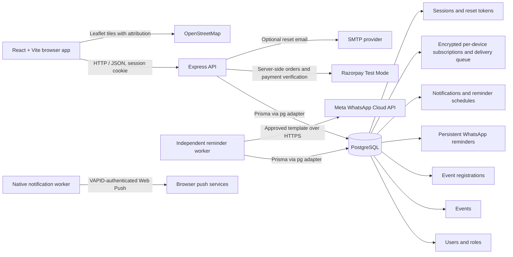

The browser calls the API using `VITE_API_URL` when set; otherwise it uses `http://localhost:3000`. The API defaults to port `3000`, and the frontend development server uses Vite's default port `5173`.

The site navigation is shared across routes and includes Home, Discover Events, About, How It Works, and FAQ, with account-specific links shown after sign-in.

## Project structure

```text
apps/
  api/
    prisma/       Prisma schema, migrations, and seed scripts
    src/          Express routes, auth, database adapters, and API tests
  web/
    src/          React routes, components, pages, auth, and styles
packages/
  shared/         Shared workspace package
README.md
docs/architecture.md
docs/release-readiness.md
docs/screenshots/
DEMO_GUIDE.md
```

## Database overview

The Prisma schema is in `apps/api/prisma/schema.prisma`.

- `User`: unique email, Argon2 password hash, role, and optional WhatsApp number/consent timestamps.
- `Event`: event details, category, draft/published state, optional capacity, venue address and
  coordinates, nullable integer-paise ticket price, and organizer ownership.
- `Registration`: joins a student to an event; `(userId, eventId)` is unique. Paid registrations
  are created only after captured payment verification.
- `EventPaymentAttempt`: per-student payment order and captured-payment state, linked to any resulting
  registration.
- `RazorpayWebhookEvent`: unique provider event IDs for webhook idempotency.
- `PasswordResetToken`: stores a token hash and expiration, linked to a user.
- `WhatsAppReminder`: durable per-registration/per-offset schedule, retry state, and provider result.
- `Notification`: user-scoped in-app notification history and event relationship.
- `NotificationPreference`: per-student in-app, push, event-reminder, and event-update settings.
- `PushSubscription`: encrypted subscription data stored separately per browser/device.
- `NotificationReminder` and `NotificationPushDelivery`: durable, unique reminder schedules and
  retryable push outbox entries.
- `Session`: PostgreSQL-backed Express session storage.

Event categories are `TECHNOLOGY`, `CULTURAL`, `SPORTS`, `WORKSHOPS`, and `HACKATHONS`. Events can be `DRAFT` or `PUBLISHED`.

## Local setup

### Prerequisites

- Node.js 22.12 or newer.
- npm.
- A local PostgreSQL instance and a database created for development.

### Install and configure

```sh
npm install
```

On Windows PowerShell, create the local environment file with:

```powershell
Copy-Item .env.example .env
```

Edit `.env` locally. Set `DATABASE_URL` to your PostgreSQL database, set a random `SESSION_SECRET` of at least 32 characters, and leave `NODE_ENV=development` for local work. The API reads this file from the repository root. Do not commit `.env` or paste its contents into logs or issue reports.

| Variable | Required | Purpose |
|---|---:|---|
| `DATABASE_URL` | Yes | PostgreSQL connection string |
| `SESSION_SECRET` | Yes | Secret used to sign session cookies (at least 32 characters) |
| `NODE_ENV` | No | `development`, `test`, or `production`; defaults to `development` |
| `PORT` | No | API listen port; defaults to `3000` |
| `FRONTEND_ORIGIN` | No | Exact browser origin allowed by credentialed CORS; defaults to `http://localhost:5173` |
| `RAZORPAY_MODE` | No | `test` by default; live mode is disabled |
| `RAZORPAY_KEY_ID`, `RAZORPAY_KEY_SECRET`, `RAZORPAY_WEBHOOK_SECRET` | For paid checkout | Razorpay test credentials; secrets stay on the API. See [payments setup](./docs/payments-setup.md) |
| `SMTP_HOST`, `SMTP_PORT`, `SMTP_SECURE`, `SMTP_USER`, `SMTP_PASSWORD`, `SMTP_FROM` | No | Configure all together to enable verification and reset email |
| `WHATSAPP_ENABLED` | No | `false` by default; enable reminders only after provider setup and approval |
| `WHATSAPP_PROVIDER` | No | `meta` by default; choose `meta` or `twilio` |
| WhatsApp provider credentials and template settings | When enabled | Configure only the selected Meta or Twilio provider; see [WhatsApp setup](./docs/whatsapp-setup.md) |
| `WHATSAPP_REMINDER_OFFSETS_HOURS` | No | Two distinct positive offsets; defaults to `24,1` |
| `PUSH_VAPID_PUBLIC_KEY`, `PUSH_VAPID_PRIVATE_KEY`, `PUSH_VAPID_SUBJECT` | No | Configure together to enable browser push; see [native notification setup](./docs/notifications-setup.md) |
| `PUSH_SUBSCRIPTION_ENCRYPTION_KEY` | With VAPID | Base64-encoded random 32-byte key used to encrypt browser subscriptions at rest |
| `VITE_API_URL` | No | API base URL when it is not the local default |
| `VITE_MAP_TILE_URL`, `VITE_MAP_ATTRIBUTION` | No | Optional public map-provider tile and attribution settings; see [maps setup](./docs/maps-setup.md) |

Use the exact frontend origin in `FRONTEND_ORIGIN`; credentialed browser requests require a matching origin. Keep secrets in local environment configuration or the hosting provider's secret manager.

When SMTP is configured, both the verification email and the forgotten-password email use the same provider. In local development, the API may fall back to a localhost-safe log-only flow when `NODE_ENV` is `development` or `test` and `FRONTEND_ORIGIN` is `localhost`/`127.0.0.1`. This is for local testing only and does not send real email.

For frontend development, no extra environment file is required for the default local API URL or
OpenStreetMap provider. Set `VITE_API_URL` only when the API is hosted at a different local URL.

See [docs/email-setup.md](./docs/email-setup.md) for the complete SMTP and email-verification setup guide.

### Migrate and run

Database migrations modify data structures. The venue/payment migration is additive and is not
applied by this implementation. Before running any migration, verify that PostgreSQL reports
`current_database() = campusconnect_test` on the same connection. Never apply this migration to the
existing `CampusConnect` or `campusconnect_demo` databases.

```sh
npm run db:migrate:dev -w apps/api
```

Apply committed migrations only after the database identity check above:

```sh
npm run db:migrate -w apps/api
```

Start the frontend and API together:

```sh
npm run dev
```

Or start either workspace independently:

```sh
npm run dev -w apps/web
npm run dev -w apps/api
```

The native event reminder worker runs independently of the API and WhatsApp integration. It uses
the database-backed reminder queue even when browser push is not configured; in-app notifications
continue to work. Start it separately:

```sh
npm run worker:notifications -w apps/api
```

The existing WhatsApp worker remains separate, optional, and disabled by default:

```sh
npm run worker -w apps/api
```

For VAPID key generation, secure subscription storage, local HTTPS, browser permission, and worker
operation, see [docs/notifications-setup.md](./docs/notifications-setup.md). The browser asks for
permission only after a student chooses **Enable** in notification preferences.

For Meta setup, template approval, worker operation, and safe testing, see
[docs/whatsapp-setup.md](./docs/whatsapp-setup.md).

For the OpenStreetMap tile configuration and usage limitations, see
[docs/maps-setup.md](./docs/maps-setup.md). For Razorpay test credentials, webhook setup, and safe
checkout testing, see [docs/payments-setup.md](./docs/payments-setup.md).

The API reads the monorepo-root `.env`. The web app is available at `http://localhost:5173`, and the API defaults to `http://localhost:3000`.

## Demo data and accounts

The demo seed is additive/upsert-based, uses stable demo-only event IDs and `.test` account emails, and never deletes records. It provisions the organizer through a trusted Prisma seed; public registration continues to create student accounts only.

**Do not run this against a development or production database.** Create a dedicated local database named `campusconnect_demo` (or `campusconnect_test`), set the root `.env` `DATABASE_URL` to that local database, and confirm the database has no important data. The seed refuses remote hosts, unapproved names, missing flags, mismatched acknowledgements, and `NODE_ENV=production`.

In PowerShell, enable the operation only for the run:

```powershell
$env:DEMO_SEED_ENABLED = "true"
$env:DEMO_SEED_DATABASE_NAME = "campusconnect_demo"
npm run db:seed:demo -w apps/api
Remove-Item Env:DEMO_SEED_ENABLED
Remove-Item Env:DEMO_SEED_DATABASE_NAME
```

The first successful run creates `.demo-credentials.local.json` at the repository root with a randomly generated password for the demo organizer and student accounts. This file is git-ignored; keep it local and do not share or commit it. The seed reuses the saved password on later runs so the local demo accounts remain usable. It upserts the known demo users, six stable-ID events, and demo registrations; running it again updates those fixtures. It does not reset or delete records. Use it only on a dedicated local demo database and do not rerun it during workflow verification.

Demo account emails:

- Organizer: `demo.organizer@campusconnect.test`
- Student: `demo.student.one@campusconnect.test`
- Student: `demo.student.two@campusconnect.test`

Read the local credential file privately to sign in. No demo passwords are committed in this repository.

## Email configuration

Password reset can send an email when all of the following are configured in `.env`: `SMTP_HOST`, `SMTP_PORT`, `SMTP_SECURE`, `SMTP_USER`, `SMTP_PASSWORD`, and `SMTP_FROM`. These settings are optional as a group. Never commit SMTP credentials.

Without SMTP, development can log a reset URL only when `NODE_ENV=development` and `FRONTEND_ORIGIN` is a localhost origin. Production requires configured email delivery and does not expose a reset link in logs.

## Testing and quality checks

```sh
npm run build
npm run lint -w apps/web
npm test -w apps/web
npm test
```

The API tests run serially (`--maxWorkers=1`). PostgreSQL integration suites are opt-in with `RUN_DB_INTEGRATION_TESTS=true` and enforce their configured local database name; run them only against the dedicated local database named in the test. Browser and responsive checks are manual; an automated end-to-end browser suite is not currently configured. See [docs/release-readiness.md](./docs/release-readiness.md) for the latest verified checks and deployment blockers.

## Screenshots and demo walkthrough

The following screenshots are captured from the running local application and use seeded event data. No credentials, cookies, or reset tokens are included.

| Screen | Screenshot |
|---|---|
| Homepage | 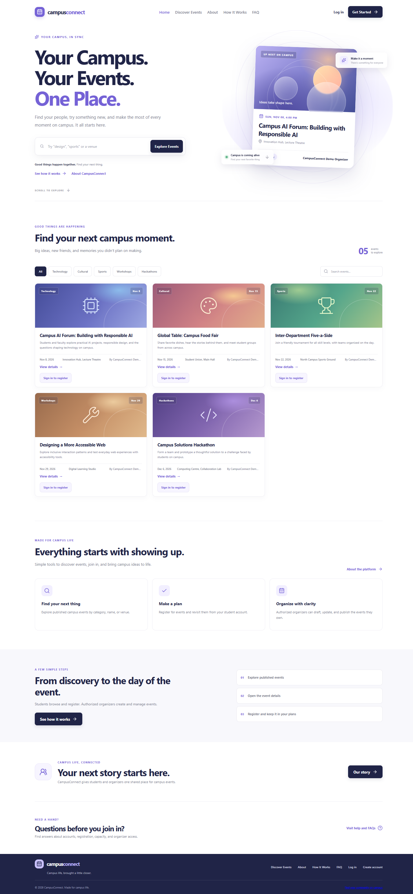 |
| About |  |
| How It Works | 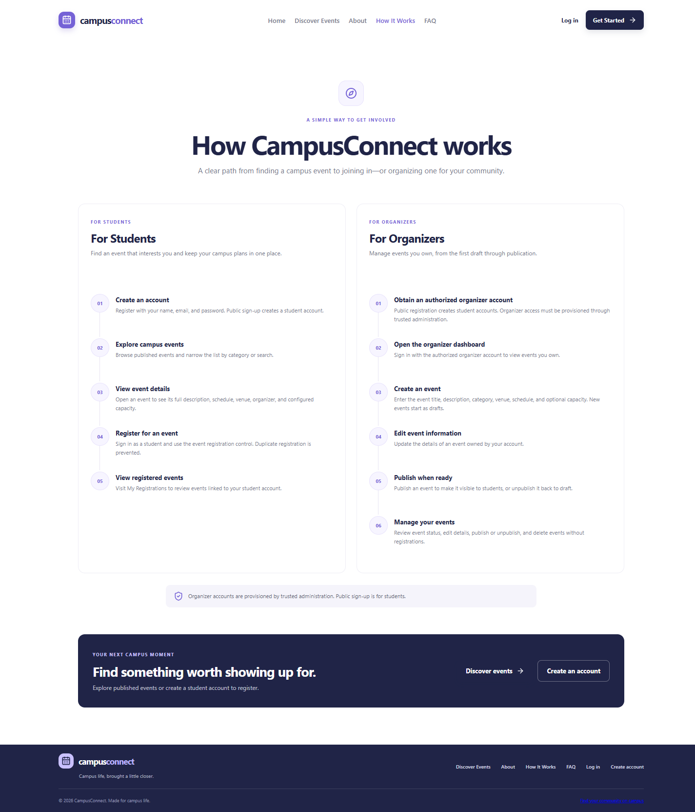 |
| FAQ | 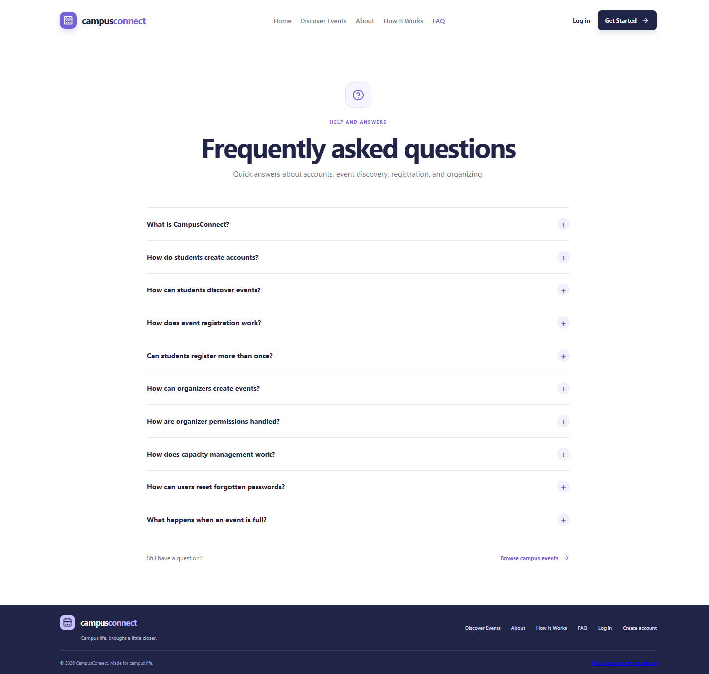 |
| Event listing | 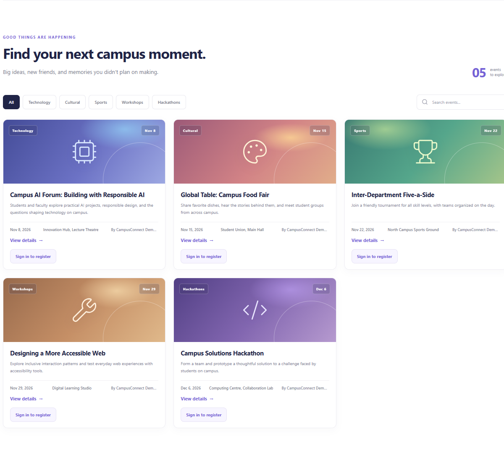 |
| Event details | 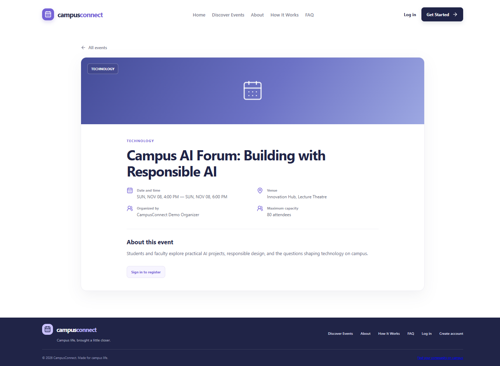 |
| Login | 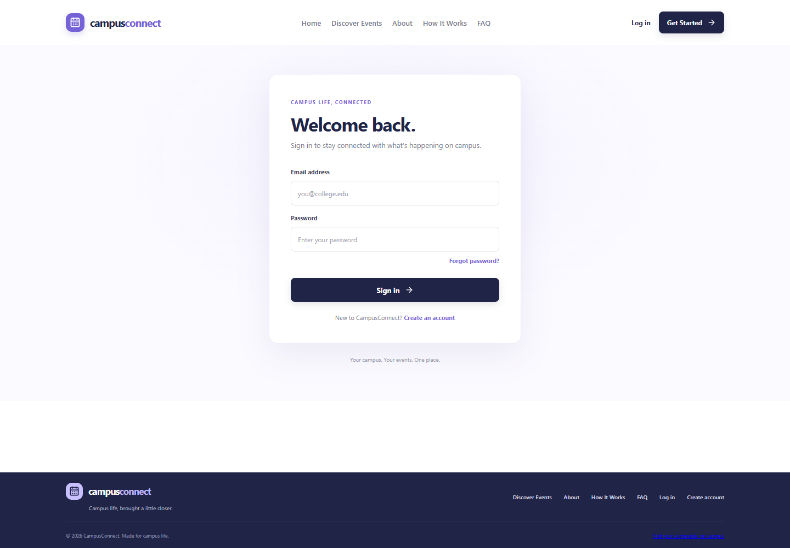 |
| Registration | 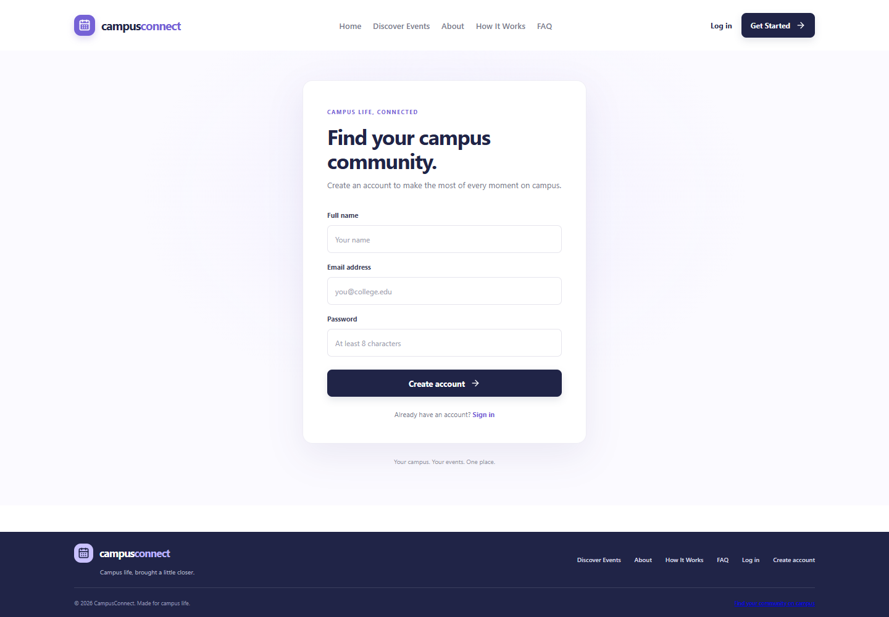 |
| My Registrations | 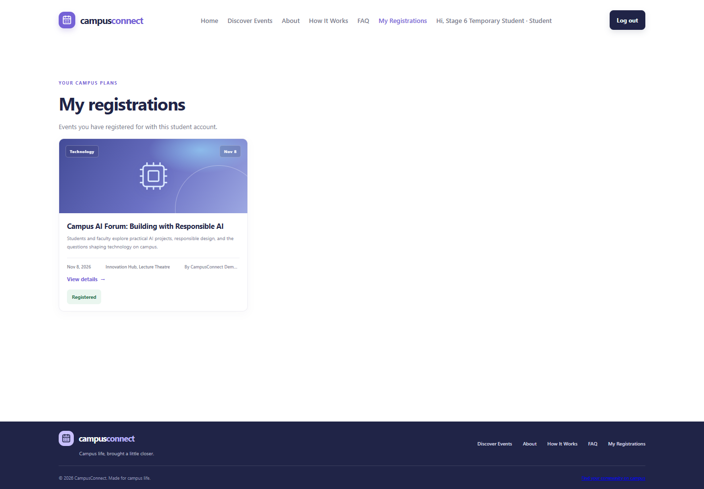 |
| Organizer dashboard | 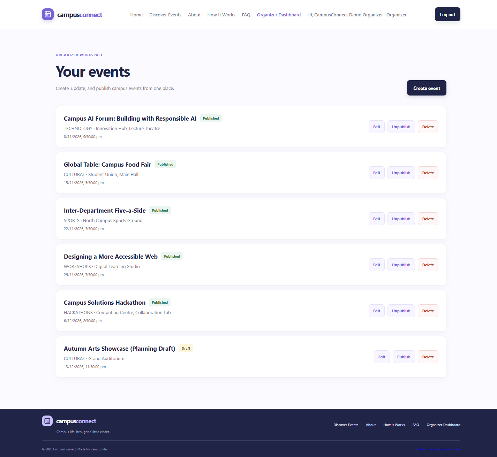 |
| Create event | 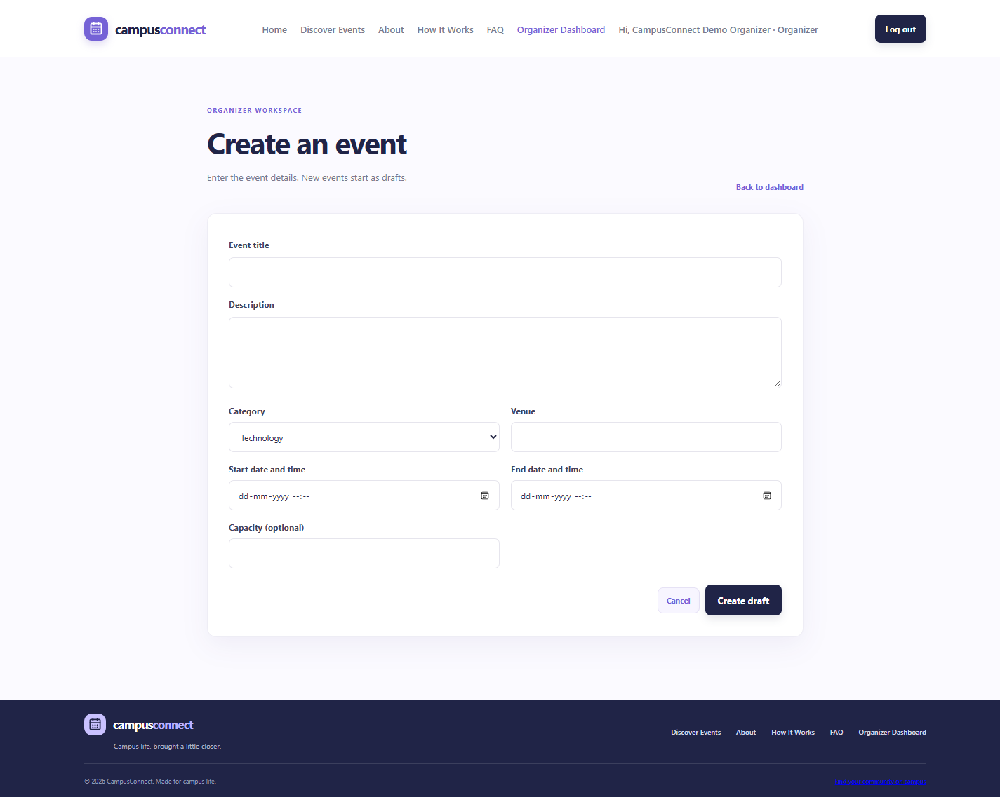 |
| Edit event | 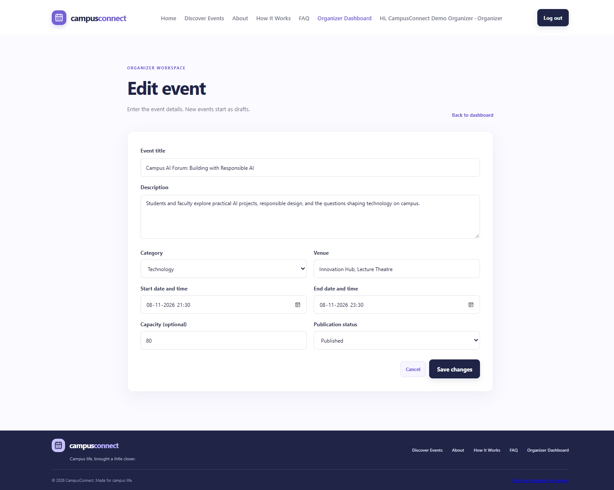 |
| Forgot Password | 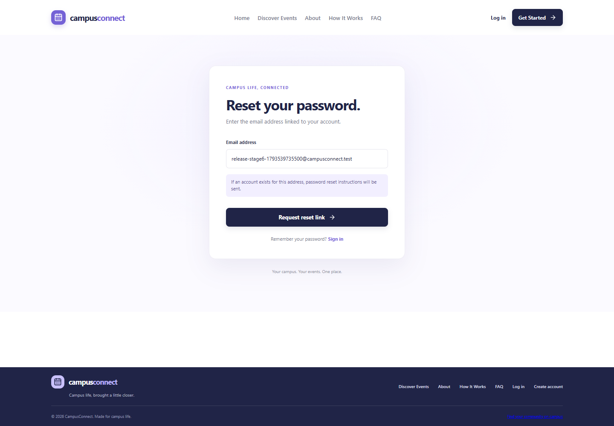 |
| Reset Password | 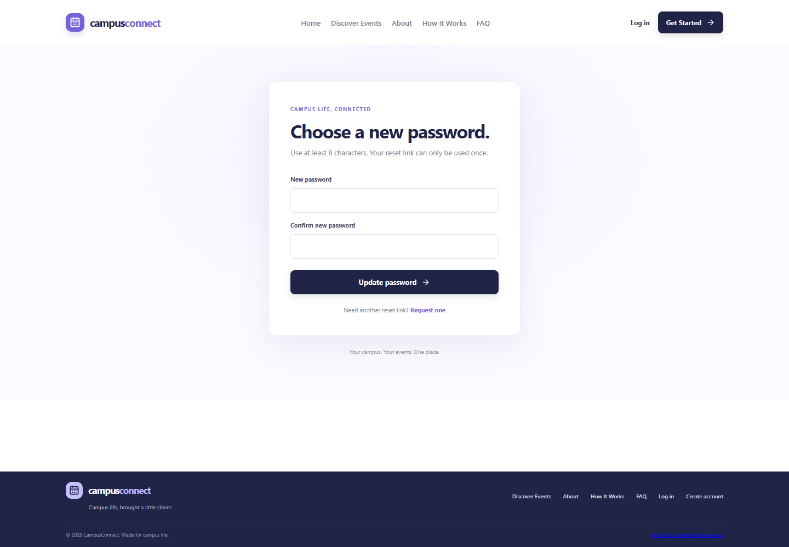 |
| Mobile homepage | 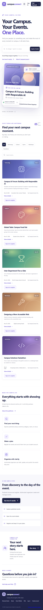 |

See [DEMO_GUIDE.md](./DEMO_GUIDE.md) for local workflow notes.

## Security

- Argon2 hashes account passwords; public registration assigns the `STUDENT` role.
- Server-side PostgreSQL sessions use `httpOnly` cookies and production-only `secure` cookies.
- Organizer operations check both the organizer role and event ownership on the server.
- Zod validates API input; database uniqueness and transactions protect registration workflows.
- Paid tickets use server-calculated paise amounts, Razorpay order IDs stored in the database,
  constant-time HMAC verification, provider-side captured-status checks, signed raw-body webhooks,
  and transaction-locked capacity reservations. Razorpay remains test-only.
- Public maps use OpenStreetMap attribution and its best-effort public tiles; no map marker is shown
  for events without coordinates.
- Password-reset tokens are random, stored as SHA-256 hashes, rate-limited, expire using PostgreSQL time, and are consumed atomically with the password update and existing-session invalidation.
- Password-reset responses do not reveal whether an email address is registered.
- Helmet supplies common HTTP security headers, and credentialed CORS is restricted to the configured frontend origin.

See [docs/release-readiness.md](./docs/release-readiness.md) for the dependency advisory and deployment security review. A currently reported Nodemailer advisory must be resolved before enabling SMTP in a public deployment.

## Known limitations

- Remaining capacity is not shown because the public API does not return current registration counts.
- SMTP is optional and must be configured for email-based password recovery outside local development.
- PostgreSQL integration tests require a dedicated database and are not part of a safe default test run.
- The hosted Render login/session issue remains unresolved; hosted authentication is not release-ready until that behavior is fixed and verified.
- The repository contains no Render deployment manifest, so service settings must be confirmed in the Render dashboard.
- Browser/responsive checks are manual; no automated end-to-end browser suite is configured.
- Password-reset rate limits are process-local and are not shared across multiple API instances.

## Roadmap

- Resolve and regression-test production session handling behind Render's TLS proxy.
- Upgrade Nodemailer to a non-vulnerable compatible release, then rerun the dependency audit before enabling SMTP.
- Add automated browser tests for student, organizer, password-reset, and responsive workflows.
- Move rate limiting to shared storage before scaling the API horizontally.
- Define cancellation behavior and strengthen capacity/registration concurrency tests.
- Add deployment health checks, structured operational logging, and email-delivery monitoring.

## Architecture documentation

See [docs/architecture.md](./docs/architecture.md) for component responsibilities, request flows, and database relationships.
