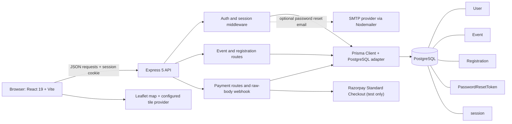

# Architecture

CampusConnect is a TypeScript monorepo with a React single-page application, an Express API, and a PostgreSQL database. The API is the security boundary: it validates requests, derives user identity from a server-side session, enforces roles and event ownership, and persists state with Prisma.

## Component diagram



## Request flow

1. React Router renders a public, student, or organizer page.
2. The frontend calls the API with JSON and `credentials: include`; Vite can proxy to a different API origin through `VITE_API_URL`.
3. Express applies Helmet, exact-origin credentialed CORS, and PostgreSQL-backed session middleware.
   The Razorpay webhook route reads the original raw request body before the general JSON parser.
4. Route schemas validate user-controlled input. Protected endpoints resolve the session user and check the current database role.
5. Repository methods use Prisma and PostgreSQL transactions/constraints for persistent operations.
   Payment orders use the event's stored integer-paise price; checkout signatures use the stored
   Razorpay order ID, then the API verifies that the provider reports a captured INR payment.
   Capacity is reserved under an event row lock until the order expires.
6. The API returns JSON and an appropriate HTTP status; frontend components render loading, error, and success states.

The API defaults to `http://localhost:3000`; the Vite development server defaults to `http://localhost:5173`. Configure the exact frontend origin in `FRONTEND_ORIGIN`. In production, HTTPS and correct reverse-proxy/session configuration are required; see [release readiness](./release-readiness.md).

## Workspace structure

```text
apps/
  api/
    prisma/
      migrations/       Ordered Prisma SQL migrations
      schema.prisma     PostgreSQL data model
      seed-demo.ts      Explicitly guarded local demo upserts
    src/
      auth.ts           Registration, login, reset and auth validation
      events.ts         Event, organizer, and registration routes
      payments.ts       Razorpay order, capture-verification, and webhook routes
      app.ts            Express middleware, Prisma repositories, router wiring
      auth*.test.ts     Auth unit and opt-in PostgreSQL regression tests
      events*.test.ts   Event unit and opt-in PostgreSQL tests
  web/
    src/
      App.tsx           Routes and landing page
      auth/             Auth context and account/recovery pages
      components/       Shared site layout, cards, and controls
      pages/            Student, organizer, and public pages
      lib/              API request and data mapping helpers
packages/
  shared/               Shared workspace package
docs/
  architecture.md
  release-readiness.md
  screenshots/
```

## Database design

The Prisma schema is [`apps/api/prisma/schema.prisma`](../apps/api/prisma/schema.prisma).

```mermaid
erDiagram
  USER ||--o{ EVENT : organizes
  USER ||--o{ REGISTRATION : makes
  USER ||--o{ EVENT_PAYMENT_ATTEMPT : pays
  EVENT ||--o{ REGISTRATION : receives
  EVENT ||--o{ EVENT_PAYMENT_ATTEMPT : reserves
  REGISTRATION o|--o| EVENT_PAYMENT_ATTEMPT : fulfills
  EVENT_PAYMENT_ATTEMPT {
    string id PK
    string userId FK
    string eventId FK
    string registrationId FK_UK
    int amountPaise
    EventPaymentStatus status
    string razorpayOrderId UK
    string razorpayPaymentId UK
    timestamptz expiresAt
  }
  RAZORPAY_WEBHOOK_EVENT {
    string id PK
    string type
    timestamptz receivedAt
  }
  USER ||--o{ PASSWORD_RESET_TOKEN : owns
  USER {
    string id PK
    string email UK
    string passwordHash
    UserRole role
  }
  EVENT {
    string id PK
    string organizerId FK
    EventStatus status
    EventCategory category
    int capacity
  }
  REGISTRATION {
    string id PK
    string userId FK
    string eventId FK
    unique userId_eventId
  }
  PASSWORD_RESET_TOKEN {
    string id PK
    string userId FK
    string tokenHash UK
    timestamptz expiresAt
  }
  SESSION {
    string sid PK
    json sess
    timestamp expire
  }
```

- A user has role `STUDENT` or `ORGANIZER`. Public sign-up always assigns `STUDENT`.
- A user may own many events. New events default to `DRAFT`; only published events are returned by public event reads.
- Registrations associate students with events. The unique `(userId, eventId)` database constraint protects against duplicates. A transaction locks an event while checking capacity and creating a registration.
- Event venue coordinates are optional and range-checked. Paid-event prices are stored as integer
  paise; a payment attempt reserves capacity and links to the existing registration only after
  capture is verified. Unique webhook event IDs make provider retries idempotent.
- Reset tokens are random, single-use bearer credentials. Only the SHA-256 token hash and database-clock expiry are stored. Consumption and password/session updates run in one transaction.
- Express session rows use the mapped `session` table and are separate from Prisma's application models.

## Trust boundaries

- The browser is not trusted to assert user IDs, roles, ownership, or event status.
- API validation and authorization are repeated on the server even when the UI hides controls.
- Organizer updates/deletes scope their database writes to both the event and session organizer.
- The browser cannot supply a trusted payment amount or order ID. Payment ownership is scoped to the
  authenticated student; only server-side captured-payment verification or a signed provider
  webhook can fulfill a paid registration.
- OpenStreetMap tile requests are client-side, visibly attributed, and not prefetched or cached by
  CampusConnect. The public tile service is not a production SLA.
- Secrets are supplied via the root `.env` for local work and should use the hosting provider's secret manager in production.
- The demo seed refuses remote database hosts, unapproved database names, missing acknowledgements, and `NODE_ENV=production`; it upserts rather than resetting data.
